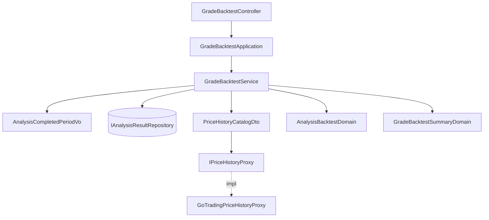

# 分析評等回測 — Architecture Design

**Status:** Confirmed
**Source PRD:** `.sdd/2026-10-09-analysis-grade-backtest/PRD.md`
**Tech context:** Go 1.26 · Gin · GORM（PostgreSQL）· Clean / Onion Architecture · 價格服務 = 自家 go-trading（`GET /k-candles/series`，Bearer 登入憑證）

---

## 1. Design Goal & Guiding Principle

- **In one sentence:** 新增 `GET /grade-backtest`（只讀、當場計算、不保存，故用 GET），查詢時讀出符合期間與標的條件的已完成分析結果（≤ 500 筆），逐筆向價格服務取 K 線，判定回測結果，彙總成命中率總表與逐筆明細。
- **Guiding principle:** **回測規則只住在 Domain Model，價格服務只是「給我 K 線」。** `AnalysisBacktestDomain` 決定要哪幾段 K 線、怎麼挑起點價格、第 N 個交易日是哪根、命中與否；`GradeBacktestSummaryDomain` 決定怎麼彙總。`IPriceHistoryProxy` 不懂命中、時間範圍、交易日——換價格來源或加市場類別都不碰規則。

---

## 2. Change Scope

| Area | Action | What / Why |
| :--- | :--- | :--- |
| `IAnalysisResultRepository` / `AnalysisResultRepository` | **Modify** | 新增 `FindForBacktest`，依分析結果建立時間（＝分析完成時間）與可選的標的 + 市場類別查詢，帶筆數上限 |
| `internal/domain/interface/` | **Add** | `IPriceHistoryProxy` |
| `internal/domain/models/domains/` | **Add** | `AnalysisBacktestDomain`、`GradeBacktestSummaryDomain` |
| `internal/domain/models/vo/` | **Add** | `GradeBacktestFilterVo`、`PriceCandleVo`、`PriceHistoryQueryVo`、`BacktestPriceWindowsVo`、`BacktestPricesVo`、`AnalysisCompletedPeriodVo` |
| `internal/domain/models/dto/` | **Add** | `GetGradeBacktestDto`、`GradeBacktestDto`、`HitRateDto`、`AnalysisBacktestDto`、`PriceHistoryCatalogDto` |
| `internal/domain/service/` | **Add** | `GradeBacktestService`、`grade_backtest_errors.go` |
| `internal/infrastructure/gotrading/` | **Add** | `GoTradingPriceHistoryProxy`（含登入）、`go_trading_wire.go` |
| `internal/application/` | **Add** | `GradeBacktestApplication` |
| `internal/controller/` | **Add** | `GradeBacktestController` |
| `cmd/server/` | **Modify** | 設定（go-trading 網址 / 帳號 / 密碼）、DI、受保護路由 `GET /grade-backtest` |
| 分析流程、分析時價格（`IPriceProxy`、`PriceSnapshotService`） | **Not touched** | 起點價格一律從價格服務取，與分析時價格無關；兩個價格介面職責不同（「現在多少」vs「某段期間的 K 線」），不合併 |
| 時段評等 / 綜合評等 | **Not touched** | PRD 明定不回測 |
| 資料表結構 | **Not touched** | 回測當場計算、不保存；不需 AutoMigrate 新 entity |

---

## 3. New Classes / Modules

| Name | Kind | Responsibility (purpose) | Collaborators | Satisfies |
| :--- | :--- | :--- | :--- | :--- |
| `IPriceHistoryProxy.FetchCandles(ctx, vo.PriceHistoryQueryVo) ([]vo.PriceCandleVo, error)` | Interface | 取某標的某段期間、某刻度的 K 線（由早到晚）。查不到標的回空切片、不是錯誤；連不上 / 登入失敗回錯誤 | — | 全部 |
| `GoTradingPriceHistoryProxy` | Proxy | 呼叫 `/k-candles/series`；把市場類別 + 標的轉成價格服務代號（台股原樣、加密貨幣加 `USDT`）；以帳號密碼 `POST /sessions` 登入，登入憑證留記憶體（mutex 保護，併發只登入一次），收到 401 重新登入重試一次；登入回覆沒有登入憑證即失敗、不重試 | `http.Client`（需帶標頭與 POST，`HttpBodyReader` 只支援 GET） | US-04 價格服務無法連線 |
| `PriceHistoryCatalogDto` | DTO | `TwStock` / `UsStock` / `Crypto` 各一個 `IPriceHistoryProxy`；nil ＝該市場無法評估 | — | US-03 美股無法評估 |
| `PriceHistoryQueryVo` | VO | `Symbol`、`Category`、`Interval`（`1m` / `1h` / `1d`）、`Since`、`Until` | — | — |
| `PriceCandleVo` | VO | `OpenTime time.Time`、`Close decimal.Decimal` | — | — |
| `BacktestPriceWindowsVo` | VO | 要查的三段：`Minute`（完成前 16 小時，1m）、`HourlyFallback`（完成前 40 天，1h）、`Daily`（完成前 10 天起、往後涵蓋所需交易日，1d） | — | US-02 |
| `BacktestPricesVo` | VO | 查回來的 `MinuteCandles`、`HourlyCandles`、`DailyCandles` | — | — |
| `AnalysisBacktestDomain` | Domain Model | 一筆分析的回測規則（見下方） | — | US-01、US-02、US-03、信心分組 |
| `GradeBacktestSummaryDomain` | Domain Model | 由 `[]dto.AnalysisBacktestDto` 建立；`ToDto() dto.GradeBacktestDto`：整體 / 市場類別 / 評等 / 信心分組命中率、中性平均漲跌幅、各回測結果筆數、隨機基準 0.5、逐筆明細 | — | US-04 |
| `GradeBacktestFilterVo` | VO | 回測條件：`Period AnalysisCompletedPeriodVo`、`Symbol`、`Category`（空＝全部標的）。service 驗證：標的與市場類別只給一個 → `ErrSymbolAndCategoryRequiredTogether`；市場類別用 `vo.NewMarketCategoryVo` 驗證並以 `vo.NewSymbolVo` 正規化標的（與分析時同寫法） | — | 指定標的 / 只給標的 / 不支援的市場類別 |
| `AnalysisCompletedPeriodVo` | VO | 建構子解析 `completedFrom` / `completedTo`（`2006-01-02`，台北時間，頭尾含），轉成 `[From, Before)`；格式錯或起日晚於迄日回 error（service 包成 `ErrBacktestPeriodInvalid`，VO 不 import service）；空字串＝不限 | — | 指定期間 / 期間不合理 |
| `GradeBacktestService.GetGradeBacktest(ctx, dto.GetGradeBacktestDto) (dto.GradeBacktestDto, error)` | Domain Service | `GetGradeBacktestDto{CompletedFrom, CompletedTo, Symbol, Category}`（原始字串）→ 建立 `GradeBacktestFilterVo`（驗證期間、標的與市場類別）→ 讀 ≤ 501 筆分析結果（501 筆即 `ErrBacktestAnalysisLimitExceeded`）→ 以 errgroup（上限 8）逐筆取價並評估 → 任一取價錯誤即 `ErrPriceServiceUnavailable` → 彙總 | `IAnalysisResultRepository`、`IClockProxy`、`PriceHistoryCatalogDto` | US-04 |
| `GradeBacktestApplication` | Application | 轉呼叫 service | `GradeBacktestService` | — |
| `GradeBacktestController` | Controller | 讀 `completedFrom` / `completedTo` / `symbol` / `category` query；錯誤對映：期間不正確 400 `backtest_period_invalid`、標的與市場類別需一起提供 400 `symbol_and_category_required_together`、市場類別不支援 400 `market_category_unsupported`、超過 500 筆 400 `backtest_analysis_limit_exceeded`、價格服務 503 `price_service_unavailable` | `GradeBacktestApplication` | US-04 |

### `AnalysisBacktestDomain` 規則

由 `domains.NewAnalysisBacktestDomain(analysisResult)` 建立（比照既有 Domain Model：`domains` 已 import `entities`，entity 上若帶 `ToXxxDomain()` 會造成循環 import）。

- `PriceWindows() vo.BacktestPriceWindowsVo`
  - 所需交易日 N：短期 10、中期 60（時間範圍非法值已在分析時正規化為短期）。
  - `Daily`：`[完成時間 − 10 天, (完成時間 + N × 7 / 5 + 30 天) 那個 UTC 日的 23:59:59]`，涵蓋連假且最後一根是完整的一天；最長約 125 根，低於價格服務單次 1000 根上限。整段期間過完、再多等一天讓最後一天的日 K 到齊，仍不足 N 根 → 無法評估。無法評估一律不帶起點價格。
- `NeedsHourlyFallback(minuteCandles) bool`：只有台股、且分 K 中沒有完成前的那一根時才需要小時 K；service 依此決定要不要再問價格服務。
- `Evaluate(vo.BacktestPricesVo, evaluatedAt time.Time) dto.AnalysisBacktestDto`（`evaluatedAt` 由 service 經 `IClockProxy` 取得）
  1. **起點價格**：`MinuteCandles` 中 `OpenTime ≤ 完成時間` 的最後一根收盤價；台股沒有則取 `HourlyCandles` 最後一根收盤價（16 小時內沒有成交，所以該小時不會含完成後的成交）；加密貨幣不退而求其次；都沒有 → **無法評估**。
  2. **起點日**：起點那根 K 線的 UTC 日（價格服務的日 K 以 UTC 零點切分；台股交易時段 01:00–05:30 UTC，UTC 日＝台北日期）。
  3. **檢查點**：`DailyCandles` 中日期晚於起點日、且那一天已收盤（台股：UTC 日起點 + 5:30，即台北 13:30；其他市場：UTC 日終點；≤ `evaluatedAt`）的第 N 根；不足 N 根 → **尚未到期**。價格服務會回傳當天仍在交易的日 K（由目前為止的分 K 彙總），不能當檢查點。
     - 交易時段內 / 收盤後完成 → 起點日＝完成當天 → 隔天是第 1 個交易日。
     - 台股開盤前完成 → 起點是前一交易日 → 完成當天是第 1 個交易日。
  4. **漲跌幅**：`(檢查點收盤 − 起點) ÷ 起點`，decimal 計算，四捨五入到小數 4 位。
  5. **回測結果**：看多 / 強烈看多 → 漲跌幅 > 0 命中；看空 / 強烈看空 → < 0 命中；其餘沒命中；中性 → `neutral`。
- `Unevaluable() dto.AnalysisBacktestDto`：市場類別沒有價格服務時（美股）由 service 呼叫，不取價。
- 信心分組：0–49 `low`、50–74 `medium`、75–100 `high`。

`AnalysisBacktestDto`：`AnalysisEventID`、`Symbol`、`Category`、`Grade`、`Confidence`、`ConfidenceBand`、`TimeHorizon`、`CompletedAt`、`EntryPrice *decimal`、`CheckpointPrice *decimal`、`CheckpointDate *string`、`PriceChangeRate *decimal`、`Outcome`（`hit` / `miss` / `neutral` / `pending` / `unevaluable`）。

`GradeBacktestDto`：`RandomBaseline 0.5`、`Overall HitRateDto`、`ByCategory map[string]HitRateDto`、`ByGrade map[string]HitRateDto`、`ByConfidenceBand map[string]HitRateDto`（三組恆完整）、`NeutralAverageChangeRate *decimal`、`OutcomeCounts map[string]int`、`Analyses []AnalysisBacktestDto`。
`HitRateDto`：`HitCount`、`MissCount`、`HitRate *float64`（分母 0 → `null`＝「沒有資料」）。

---

## 4. Modified Components

| Component | Current role | Change needed |
| :--- | :--- | :--- |
| `IAnalysisResultRepository` | `Create`、`FindByAnalysisEventID` | 加 `FindForBacktest(ctx, vo.GradeBacktestFilterVo, limit int) ([]entities.AnalysisResult, error)`：只取分析事件狀態為已完成者（子查詢 `analysis_events`；分析結果先於事件狀態寫入，狀態更新失敗時會留下結果）、`created_at` 在期間內、有標的時加 `symbol` + `category` 條件、依 `created_at` 舊到新、`Limit(limit)`；重新產生 mock |
| `config.go` | 讀環境變數 | `GO_TRADING_BASE_URL`（無預設值，去掉結尾 `/`；本服務自己預設佔用 8080，不能拿來當 go-trading 的預設）、`GO_TRADING_EMAIL`、`GO_TRADING_PASSWORD`（任一為空 → 每次回測都是價格服務無法使用，不擋啟動） |
| `dependencies.go` | DI、路由 | 組 `GoTradingPriceHistoryProxy`、`PriceHistoryCatalogDto{TwStock, Crypto: 同一個 proxy; UsStock: nil}`、service / application / controller；`protectedRoutes.GET("/grade-backtest", ...)` |
| `.env.example`、`postman/`、`.sdd/PROJECT.md` | 文件 | 補新設定與路由 |

---

## 5. Component Relationships

---

## 6. Extensibility & Handoff Notes

- **Most likely next requirement:** 美股也要回測；其次是「固定 1 / 5 / 20 天」等其他檢查點。
- **Where it lands:** 美股 → `PriceHistoryCatalogDto.UsStock`；其他檢查點 → `AnalysisBacktestDomain` 的「所需交易日」。
- **How to add it:** 美股：新增 `YahooFinancePriceHistoryProxy` 實作 `IPriceHistoryProxy`，在組裝根填入 `UsStock`；另需在 `AnalysisBacktestDomain` 補上美股的收盤時間（紐約時區、含夏令時間），讓「當天是否已收盤」與「小時 K 退而求其次」把美股當會收盤的市場——目前這兩條只對台股成立，其他市場一律視為全天交易。彙總不動。其他檢查點：讓 `AnalysisBacktestDomain` 回傳多個檢查點的結果，`GradeBacktestSummaryDomain` 依檢查點分組，取價邏輯不動（`Daily` 視窗加長即可）。
- **Patterns applied & why:** 依市場類別的 proxy catalog 沿用 `PriceProviderCatalogDto` 的做法；Domain Model 一進（K 線）一出（DTO），service 只負責取資料與併發。
- **Do not hardcode:** go-trading 網址與帳密（設定）。
- **Known debt / deferred:** 同一標的多筆分析會各自取價（最多 500 × 2–3 次呼叫，併發 8，每次日 K 查詢讓價格服務彙總約 125 天的分 K）；code review 已點出，慢到有感時再依標的合併日 K 查詢。登入憑證只在記憶體，服務重啟會重新登入一次。

---

## 7. Traceability

| PRD Scenario | Fulfilled by |
| :--- | :--- |
| US-01 看多上漲 / 看空下跌 / 強烈看多下跌 / 價格沒變 | `AnalysisBacktestDomain.Evaluate`（步驟 4–5） |
| US-01 中性不計入命中率 | `AnalysisBacktestDomain.Evaluate`（`neutral`）+ `GradeBacktestSummaryDomain`（中性平均漲跌幅） |
| US-02 交易時段內 / 收盤後 / 週末加密貨幣的起點價格 | `AnalysisBacktestDomain.PriceWindows` + `Evaluate` 步驟 1 |
| US-02 開盤前完成，當天即第 1 個交易日 / 交易時段內完成，隔天才是第 1 個 | `Evaluate` 步驟 2–3 |
| US-02 分析時價格未取得仍可評估 | `AnalysisBacktestDomain` 不讀分析時價格 |
| US-03 尚未到期 | `Evaluate` 步驟 3 |
| US-03 美股無法評估 | `PriceHistoryCatalogDto.UsStock == nil` → `Unevaluable()` |
| US-03 價格服務沒登錄的代號 | `IPriceHistoryProxy` 回空 → `Evaluate` 步驟 1 無法評估 |
| US-03 失敗的分析不出現 | 只讀分析結果（失敗的分析沒有分析結果） |
| US-04 整體命中率與隨機比較、分組、沒有資料、中性平均 | `GradeBacktestSummaryDomain.ToDto` |
| US-04 信心 75 → 高、74 → 中 | `AnalysisBacktestDomain` 信心分組 |
| US-04 指定期間 / 不指定期間 / 期間不合理 | `AnalysisCompletedPeriodVo` + `FindForBacktest` |
| US-04 指定標的 / 標的寫法一致 / 只給標的 / 不支援的市場類別 | `GradeBacktestFilterVo` + `FindForBacktest` |
| US-04 逐筆明細 | `AnalysisBacktestDto` |
| US-04 超過 500 筆 / 剛好 500 筆 | `GradeBacktestService`（limit 501 → 501 筆即拒絕） |
| US-04 價格服務無法連線 | `GoTradingPriceHistoryProxy` 錯誤 → `ErrPriceServiceUnavailable` → 503 |
| US-04 未啟用的 API key | 既有 `RequireActiveApiKey` |

---

## 8. Risks & Open Decisions

- **Risks / trade-offs:**
  - 價格服務只存 1 分 K、其他刻度都由它彙總；舊分析若沒有 1 分 K 歷史就是無法評估（PRD 已列風險）。
  - 加密貨幣的日 K 以 UTC 零點切分，「交易日」為 UTC 日；台股不受影響。
  - 帳密放 `.env`：個人專案可接受；換成 OAuth 續用憑證需處理一次性換發，暫不做。
- **Open decisions (for implementation):** 無。
