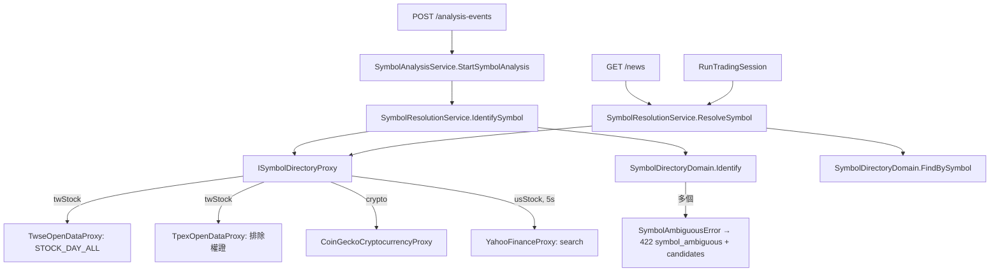

# 以名稱發起分析 — Architecture Design

**Status:** Confirmed
**Source PRD:** `.sdd/2026-10-28-symbol-name-input/PRD.md`
**Tech context:** Go · Gin · Clean / Onion（`domain/models/{entities,domains,dto,vo}`）· mockery

---

## 1. Design Goal & Guiding Principle

- **In one sentence:** 發起分析改走新的 `SymbolResolutionService.IdentifySymbol`。它向各市場的「標的名錄」取得一份上市清單（`[]vo.SymbolListingVo`），交給新的 Domain Model `SymbolDirectoryDomain` 依「代號或名稱完全相同 → 名稱包含」比對出唯一標的、或候選、或找不到。新聞搜尋與追蹤標的的自動分析仍走只認代號的 `ResolveSymbol`，但兩者共用同一份名錄與同一個 Domain Model。
- **Guiding principle:** 每個市場的資料來源統一抽象成一個能力：「給我一個查詢字，回我可能的標的清單」（`ISymbolDirectoryProxy`）。**「怎麼比對、誰算唯一、候選怎麼排」全部只在 `SymbolDirectoryDomain` 決定**；proxy 只負責把供應商資料正規化成 `SymbolListingVo`，service 只負責去哪裡取資料、以及錯誤怎麼分流。要新增市場或換資料來源，只要再實作一個 proxy。

---

## 2. Change Scope

| Area | Action | What / Why |
| :--- | :--- | :--- |
| `interfaces.ISymbolDirectoryProxy` | **Add** | `SearchSymbolListings(ctx, query string) ([]vo.SymbolListingVo, error)`。供應商可以回多於符合的清單（台股名單直接回全部），比對交給 domain |
| `interfaces.IListedCompanyProxy` / `ICryptocurrencyProxy`（含 mocks、`.mockery.yaml`） | **Remove** | 兩者都被 `ISymbolDirectoryProxy` 取代。美股名稱改由搜尋結果帶出，不再需要以代號查公司名稱 |
| `vo.SymbolListingVo` | **Add** | 名錄中的一筆：`Symbol`、`Name`、`Priority`（越小越前：台股 0、加密貨幣為市值排名、無排名為 `math.MaxInt`、美股為搜尋結果順序） |
| `domains.SymbolDirectoryDomain` | **Add** | 比對規則的唯一所在地（見 §3） |
| `vo.SymbolIdentificationVo` | **Add** | `Identify` 的結果：`Listing`、`IsIdentified`、`IsIdentifiedBySymbol`、`Candidates []vo.SymbolListingVo` |
| `dto.SymbolCandidateDto` | **Add** | 對外的候選：`Symbol`、`SymbolName`（json `symbol` / `symbolName`） |
| `service.SymbolAmbiguousError` + `ErrSymbolAmbiguous` | **Add** | 帶候選的錯誤；`Unwrap()` 回 `ErrSymbolAmbiguous`，讓 controller 以 `errors.Is` 對映狀態碼、以 `errors.As` 取出候選 |
| `dto.SymbolDirectoryCatalogDto` | **Modify** | `TwStock []ISymbolDirectoryProxy`、`UsStock ISymbolDirectoryProxy`、`Crypto ISymbolDirectoryProxy` |
| `SymbolResolutionService` | **Modify** | `ResolveSymbol` 只認代號（行為不變，只是改以名錄 + `FindBySymbol` 實作）；新增 `IdentifySymbol`；移除 `NameResolvedSymbol`（美股名稱改由 `IdentifySymbol` 從搜尋結果取得） |
| `vo.NewUsStockResolvedSymbolVo` | **Modify** | 多收 `companyName`；`ResolveSymbol` 傳空字串 |
| `SymbolAnalysisService.StartSymbolAnalysis` | **Modify** | 改呼叫 `IdentifySymbol`，拿掉 `NameResolvedSymbol` 呼叫；重用判斷照舊以辨識出的代號 |
| `TwseOpenDataProxy` | **Modify** | 名錄改用 `STOCK_DAY_ALL`（含 ETF）：`twseDailyClosing` 加 `Name`，`SearchSymbolListings` 回整份清單；移除 `t187ap03_L`、`FindCompanyShortName`、`shortNamesCache`、`TwseOpenDataUrls.ListedCompanies` |
| `TpexOpenDataProxy` | **Modify** | `SearchSymbolListings` 回整份清單，排除權證（6 碼且 `7` 開頭）；移除 `FindCompanyShortName` |
| `CoinGeckoCryptocurrencyProxy` | **Modify** | `FindCoinName` 換成 `SearchSymbolListings(query)`：回整份搜尋結果，`Priority` 為市值排名；快取改以「小寫後的查詢字」為鍵，快取清單 |
| `YahooFinanceProxy` | **Modify** | 新增 `SearchSymbolListings`：打 Yahoo search（`quotesCount=20&newsCount=0`），只留 `quoteType` 為 `EQUITY`/`ETF` 且交易所屬美國（`NMS NGM NCM NAS NYQ NYS ASE PCX BTS`，以及 OTC 的 `PNK OQB OQX`）者；名稱取 `longname`，空則 `shortname`；代號 `BRK-B` 轉回 `BRK.B`；移除 `FindCompanyShortName` 與 chart 回應的 `shortName`/`longName` |
| `controller`（`ErrorDetail`、`ErrorResponseTable.Respond`、`analysisEventErrorResponseTable`） | **Modify** | `ErrorDetail` 加 `Candidates []dto.SymbolCandidateDto json:"candidates,omitempty"`；`Respond` 以 `errors.As` 帶出候選；`ErrSymbolAmbiguous` 對映 **422** `symbol_ambiguous` |
| `cmd/server/dependencies.go` | **Modify** | 組裝新的名錄；`ExternalSourceUrls` 移除 `TwseListedCompanies`，新增 `YahooFinanceSearch: https://query1.finance.yahoo.com/v1/finance/search` |
| `postman/`、`.sdd/PROJECT.md` | **Modify** | 補「符合多個標的」的回應範例 |
| 搜尋標的新聞的對外行為、AI 分析、價格取得、重用時間窗、評等回測 | **Not touched** | PRD 範圍外；新聞搜尋仍只認代號（美股仍不查），避免每次搜尋多一次美股外部查詢 |

---

## 3. New Classes / Modules

| Name | Kind | Responsibility (purpose) | Collaborators | Satisfies (PRD scenario) |
| :--- | :--- | :--- | :--- | :--- |
| `ISymbolDirectoryProxy` | Interface | 依查詢字回傳某市場的候選標的清單 | TWSE / TPEx / CoinGecko / Yahoo proxy | US-01～US-03 全部 |
| `vo.SymbolListingVo` | VO | 名錄一筆的正規化形狀 | — | 同上 |
| `domains.SymbolDirectoryDomain` | Domain Model | `NewSymbolDirectoryDomain(category, listings)`：丟掉代號為空的列，以及台股、加密貨幣名稱為空的列（它們以名稱搜尋新聞；美股名稱可為空），依 `(Priority, Symbol)` 穩定排序。`FindBySymbol(symbol)`：代號完全相同的第一筆。`Identify(symbol)` 回傳（辨識結果、候選、是否辨識到），錯誤由 service 產生：第一層「代號或名稱完全相同」取第一筆；第二層「名稱包含」唯一即採用、多個則回最多 10 個候選；都沒有即找不到。比對前去前後空白、轉小寫、合併連續空白；美股名稱另去除 `,` `.` 與結尾的公司字尾（Inc、Incorporated、Corp、Corporation、Co、Company、Ltd、Limited、PLC、LP、LLC、SA、NV、AG、Holdings，可連續去除） | `SymbolListingVo`、`SymbolIdentificationVo` | US-01～US-03 的比對、唯一、候選情境 |
| `vo.SymbolIdentificationVo` | VO | `Identify` 的結果 | — | 同上 |
| `dto.SymbolCandidateDto` | DTO | 候選的對外形狀 | — | 名稱符合多個標的的情境 |
| `service.SymbolAmbiguousError` | Error type | 攜帶候選；`Error()` 為「符合多個標的，請改填代號或更完整的名稱」 | controller | 名稱符合多個標的的情境 |

---

## 4. Modified Components

| Component | Current role | Change needed |
| :--- | :--- | :--- |
| `SymbolResolutionService.ResolveSymbol` | 代號 → 搜尋字（新聞搜尋、自動分析） | 台股與加密貨幣：以 private `searchDirectories`（與 `IdentifySymbol` 共用，依市場併發取所有名錄、保留讀得到的清單並回傳合併錯誤）→ `FindBySymbol`；找到即回，否則有名錄失敗回 `ErrNewsProvidersUnavailable`，否則 `ErrSymbolNotFound`。美股：不查，名稱空 |
| `SymbolResolutionService.IdentifySymbol`（新） | — | 台股：取名錄 → `Identify`；以代號辨識到即回；有名錄失敗回 `ErrNewsProvidersUnavailable`；辨識到即回；有候選回 `SymbolAmbiguousError`；否則 `ErrSymbolNotFound`。加密貨幣：`SearchSymbolListings(填的字)`，失敗回 `ErrNewsProvidersUnavailable`，之後同上。美股：5 秒上限內 `SearchSymbolListings(填的字)`；失敗則照現行以填的字當代號、名稱空；其餘同上 |
| `SymbolAnalysisService.StartSymbolAnalysis` | 辨識 → 重用或建立 | `ResolveSymbol` 換成 `IdentifySymbol`；刪除 `NameResolvedSymbol` 呼叫 |
| `ErrorResponseTable.Respond` | 依哨兵錯誤回應 | 回應時若 `errors.As(err, &*service.SymbolAmbiguousError)`，把候選放進 `ErrorDetail.Candidates` |

---

## 5. Component Relationships

---

## 6. Extensibility & Handoff Notes

- **Most likely next requirement:** 操作台輸入時即時提示候選（自動完成），或新聞搜尋也接受名稱。
- **Where it lands:** `SymbolDirectoryDomain` 已能產生排序好的候選；自動完成只需在 `SymbolResolutionService` 加一個「列出候選」的方法，取名錄後呼叫 domain，再開一支查詢 API。新聞搜尋接受名稱則是把 `NewsSearchService` 改呼叫 `IdentifySymbol`。
- **How to add it:** 新市場或新名錄來源 → 實作 `ISymbolDirectoryProxy`、在 `SymbolDirectoryCatalogDto` 註冊；比對規則（如中英對照別名）→ 只改 `SymbolDirectoryDomain`。
- **Patterns applied & why:** 名錄統一成單一能力介面（Strategy by market），比對規則集中在單一 Domain Model；候選以帶資料的錯誤型別傳到邊界，沿用既有「哨兵錯誤 → 狀態碼」表。
- **Do not hardcode:** 候選上限（`maximumSymbolCandidates = 10`）、美股名錄等待上限（`usStockDirectoryLookupTimeout = 5s`）以具名常數放在各自擁有者旁邊。
- **Known debt / deferred:** 權證辨識規則（6 碼 `7` 開頭）寫在 TPEx proxy，因為它是櫃買代號編碼的知識；若日後要支援更多商品類型，應改由 listing 帶「商品類型」交給 domain 判斷。

---

## 7. Traceability

| PRD Scenario | Fulfilled by |
| :--- | :--- |
| US-01 以代號發起分析 | `IdentifySymbol` + `SymbolDirectoryDomain.Identify`（代號完全相同） |
| US-01 以公司簡稱發起分析 | `SymbolDirectoryDomain.Identify`（名稱完全相同） |
| US-01 上市 ETF 可以被辨識 | `TwseOpenDataProxy.SearchSymbolListings`（STOCK_DAY_ALL 含 ETF） |
| US-01 以上櫃 ETF 名稱發起分析 | `TpexOpenDataProxy.SearchSymbolListings` + `Identify` |
| US-01 唯一部分符合即採用 | `Identify`（名稱包含、唯一） |
| US-01 完全相同優先於部分符合 | `Identify`（第一層先於第二層） |
| US-01 名稱符合多個標的 | `Identify`（候選上限 10、依代號排序）+ `SymbolAmbiguousError` + `ErrorResponseTable.Respond`（422 + candidates） |
| US-01 找不到標的 | `IdentifySymbol` → `ErrSymbolNotFound`（404） |
| US-01 權證不辨識 | `TpexOpenDataProxy` 排除權證 |
| US-01 台股名單暫時取不到 | `IdentifySymbol`（名錄失敗且非代號命中 → `ErrNewsProvidersUnavailable`） |
| US-02 以代號發起分析 | `CoinGeckoCryptocurrencyProxy.SearchSymbolListings` + `Identify` |
| US-02 以幣種名稱發起分析，不分大小寫 | `SymbolDirectoryDomain` 正規化（轉小寫） |
| US-02 代號或名稱完全相同的有多個時取市值排名最前 | `SymbolDirectoryDomain` 依 `Priority`（市值排名）排序 |
| US-02 名稱符合多個幣種 | `Identify` 候選 + `SymbolAmbiguousError` |
| US-02 找不到幣種 | `IdentifySymbol` → `ErrSymbolNotFound` |
| US-03 以代號發起分析 | `YahooFinanceProxy.SearchSymbolListings` + `Identify`（名稱帶入） |
| US-03 填的字不是已知標的時改以標的名稱比對 | `Identify`（TESLA 與「Tesla, Inc.」正規化後相同） |
| US-03 不計公司字尾後完全相同 | `SymbolDirectoryDomain` 美股名稱正規化 |
| US-03 名稱符合多個美股 | `Identify` 候選 + `SymbolAmbiguousError` |
| US-03 只考慮美國掛牌的股票與 ETF | `YahooFinanceProxy` 過濾 `quoteType` 與交易所 |
| US-03 美股資料來源可用但查無此標的 | `IdentifySymbol` → `ErrSymbolNotFound` |
| US-03 美股資料來源暫時無法使用 | `IdentifySymbol`（名錄失敗 → 以填的字當代號、名稱空） |
| US-04 名稱發起的分析重用代號發起的分析 | `StartSymbolAnalysis`（以辨識出的代號查重用） |
| US-04 超過重用時間窗時重新分析 | `StartSymbolAnalysis`（既有重用規則） |
| US-05 追蹤標的照常分析 | `ResolveSymbol`（代號）不變 |
| US-05 追蹤上市 ETF | `ResolveSymbol` + `TwseOpenDataProxy`（STOCK_DAY_ALL） |

---

## 8. Risks & Open Decisions

- **Risks / trade-offs:**
  - 台股名錄改用每日收盤行情，當天暫停交易者暫時辨識不到；可接受（反正取不到收盤價）。
  - Yahoo search 為非正式介面；任何失敗都退回現行「以填的字當代號」，不阻斷分析。
  - 美股以代號發起也改經 search，若 search 對冷門代號不回該代號，會判找不到；以 search 對代號查詢的精確度實測為準。
- **Open decisions (for implementation):** 無。
