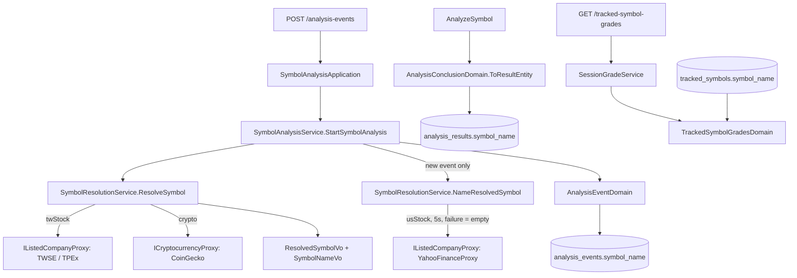

# 標的名稱 — Architecture Design

**Status:** Confirmed
**Source PRD:** `.sdd/2026-10-28-symbol-name/PRD.md`
**Tech context:** Go · Gin · GORM（Postgres，code-first `AutoMigrate`）· Clean / Onion（`domain/models/{entities,domains,dto,vo}`）

---

## 1. Design Goal & Guiding Principle

- **In one sentence:** 標的辨識（`ResolveSymbol`）在產出搜尋字的同時帶出台股 / 加密貨幣本來就查得到的標的名稱（`SymbolNameVo`）；只有「建立新分析事件」時才呼叫 `NameResolvedSymbol` 補上美股公司名稱。名稱存進分析事件、分析完成時複製到分析結果；追蹤標的則由 administrator 填 `tracked_symbols.symbol_name`，查詢評等時帶出。
- **Guiding principle:** **「標的名稱從哪來」只在 `SymbolResolutionService` 決定。** 呼叫端只拿 `ResolvedSymbolVo.SymbolName`，不知道各市場各問誰。需要額外對外查詢的美股名稱獨立成 `NameResolvedSymbol`，只在真正會保存名稱的路徑（建立新分析事件）呼叫——新聞搜尋、自動分析、重用既有分析都不會多打一次外部服務（code review 後修正）。

---

## 2. Change Scope

| Area | Action | What / Why |
| :--- | :--- | :--- |
| `entities.TrackedSymbol` / `AnalysisEvent` / `AnalysisResult` | **Modify** | 各加 `SymbolName string` `gorm:"size:100;not null;default:''"`；`AutoMigrate` 新增欄位，既有資料為空字串（不回補） |
| `vo.SymbolNameVo` | **Add** | 標的名稱的正規化：去前後空白、最多 100 個字元（rune） |
| `vo.ResolvedSymbolVo` | **Modify** | 加 `SymbolName SymbolNameVo`；台股 / 加密貨幣建構子帶入名稱，美股建構子名稱為空 |
| `SymbolResolutionService` | **Modify** | `ResolveSymbol` 行為不變（美股名稱為空）；新增 `NameResolvedSymbol`：美股且尚無名稱時向 `SymbolDirectoryCatalogDto.UsStock` 查公司名稱，5 秒上限；錯誤 / 查無 / 逾時 → 空名稱，**不拒絕** |
| `dto.SymbolDirectoryCatalogDto` | **Modify** | 加 `UsStock interfaces.IListedCompanyProxy` |
| `YahooFinanceProxy` | **Modify** | 實作既有介面 `IListedCompanyProxy.FindCompanyShortName`：讀 chart `meta.shortName`（空則 `longName`） |
| `AnalysisEventDomain` | **Modify** | `NewStartedAnalysisEventDomain` 改收 `vo.ResolvedSymbolVo`（取代 `vo.SymbolVo`），存入名稱；`ToDto` 帶出事件與結果的名稱 |
| `AnalysisConclusionDomain.ToResultEntity` | **Modify** | 從分析事件複製 `SymbolName` 到分析結果 |
| `TrackedSymbolGradesDomain.ToDtos` | **Modify** | 以追蹤標的（正規化後的 `SymbolVo`）對應登記名稱，帶入 `TrackedSymbolGradeDto.SymbolName` |
| `dto.AnalysisEventDto` / `AnalysisResultDto` / `TrackedSymbolGradeDto` | **Modify** | 加 `SymbolName string` `json:"symbolName"`（不 omitempty，空時明確回 `""`） |
| `cmd/server/dependencies.go` | **Modify** | 把 `YahooFinanceProxy` 接進 `SymbolDirectoryCatalogDto.UsStock` |
| `postman/` | **Modify** | 回應範例加 `symbolName` |
| 新聞搜尋、AI 分析、重用規則、時段評等 / 綜合評等、評等回測 | **Not touched** | 名稱只存與顯示；搜尋字不變；時段 / 綜合評等不存名稱（查詢時由追蹤標的帶出） |
| 發起分析 API 的 request | **Not touched** | 不收名稱 |

---

## 3. New Classes / Modules

| Name | Kind | Responsibility (purpose) | Collaborators | Satisfies (PRD scenario) |
| :--- | :--- | :--- | :--- | :--- |
| `vo.SymbolNameVo` | VO | 標的名稱的唯一正規化點：`NewSymbolNameVo(raw)` 去空白、截到 100 rune；`Value` 給 entity 存 | `ResolvedSymbolVo` | US-02 全部（名稱長度規則） |

> 只新增一個 VO。美股名稱沿用既有 `IListedCompanyProxy`（能力本來就是「依代號查公司簡稱」），不新開介面。

---

## 4. Modified Components

| Component | Current role | Change needed |
| :--- | :--- | :--- |
| `SymbolResolutionService.NameResolvedSymbol`（新方法） | — | 非美股或已有名稱 → 原樣回傳；美股：`context.WithTimeout(ctx, usStockCompanyNameLookupTimeout=5s)` 查 `UsStock.FindCompanyShortName`，任何失敗只得空名稱 |
| `ResolvedSymbolVo` 建構子 | 決定搜尋字與相關詞 | 台股 / 加密貨幣：名稱 = 公司簡稱 / 幣種名稱；美股名稱為空，搜尋字仍為代號 |
| `SymbolAnalysisService.StartSymbolAnalysis` | 辨識 → 重用或建立分析事件 | 建立前呼叫 `NameResolvedSymbol` 再傳給 `NewStartedAnalysisEventDomain`；重用路徑不查名稱（回傳舊名稱） |
| `YahooFinanceProxy` | 美股新聞、價格 | 新增 `FindCompanyShortName`；chart 回應 struct 加 `shortName`/`longName` |
| `TrackedSymbolGradesDomain.ToDtos` | 組追蹤標的評等 | 由 `isTracking map[SymbolVo]bool` 改為 `symbolNames map[SymbolVo]string`（存在即追蹤中）；登記名稱經 `SymbolNameVo` 正規化（只有空白視為空），正規化後同一標的的重複列不讓空名稱蓋掉已登記名稱 |

---

## 5. Component Relationships

---

## 6. Extensibility & Handoff Notes

- **Most likely next requirement:** 美股要中文名稱、或想換名稱來源 / 加快取；或其他回應（回測、新聞搜尋）也要顯示名稱。
- **Where it lands:** 名稱來源 → `SymbolDirectoryCatalogDto` 裡對應市場的 `IListedCompanyProxy` 實作（換掉或包一層快取 proxy）；名稱規則 → `SymbolNameVo`。其他回應要名稱 → 讀已存的 `analysis_results.symbol_name`（回測本來就讀分析結果）。
- **How to add it:** 新增一個實作 `IListedCompanyProxy` 的 proxy，在組裝根換進 `UsStock`；不必動 service。
- **Patterns applied & why:** 沿用既有「目錄 catalog + 能力介面」的 strategy 形狀，讓名稱來源可替換。
- **Do not hardcode:** 名稱長度只在 `SymbolNameVo`；美股查詢上限只在 `usStockCompanyNameLookupTimeout`。
- **Known debt / deferred:** 建立美股新分析事件時查一次名稱、分析完成時取價又讀一次同一個 Yahoo chart（時間點不同，不共用）；若被限流，再加快取（比照台股目錄的快取）。

---

## 7. Traceability

| PRD Scenario | Fulfilled by |
| :--- | :--- |
| US-01 有登記標的名稱的追蹤標的 | `TrackedSymbol.SymbolName` + `TrackedSymbolGradesDomain.ToDtos` + `TrackedSymbolGradeDto.SymbolName` |
| US-01 沒有登記標的名稱的追蹤標的 | 同上（欄位預設空字串，`json:"symbolName"` 回 `""`） |
| US-01 登記的標的名稱不影響自動分析的搜尋字 | `SessionGradeService` 不讀 `TrackedSymbol.SymbolName`，仍經 `ResolveSymbol` 取搜尋字 |
| US-01 以查詢當下登記的標的名稱為準 | `GetTrackedSymbolGrades` 每次讀 `FindAllTracking`；時段 / 綜合評等不存名稱 |
| US-02 台股以公司簡稱為標的名稱 | `NewTwStockResolvedSymbolVo` → `NewStartedAnalysisEventDomain` → `ToResultEntity` 複製 → `ToDto` |
| US-02 加密貨幣以幣種名稱為標的名稱 | `NewCryptoResolvedSymbolVo` |
| US-02 美股以報價來源提供的公司名稱為標的名稱 | `YahooFinanceProxy.FindCompanyShortName` + `NameResolvedSymbol`；搜尋字仍為代號 |
| US-02 美股報價來源暫時查不到資料 | `NameResolvedSymbol`：錯誤 / 逾時 → 空名稱、不回錯 |
| US-02 美股報價來源查無此代號 | 同上（`found=false` → 空名稱、不回 `ErrSymbolNotFound`） |
| US-02 台股查無此標的仍然拒絕 | `ResolveSymbol` 台股分支不變（`ErrSymbolNotFound`） |
| US-02 重用既有分析時沿用原本的標的名稱 | `StartSymbolAnalysis` 重用路徑回傳既有 entity 的 `SymbolName` |
| US-02 分析失敗仍附上標的名稱 | 名稱於建立分析事件時即存；`AnalysisEventDomain.ToDto` 不論狀態都帶出 |
| US-03 本功能開始使用前發起的分析 | `AutoMigrate` 新欄位 `default:''`，不回補 |
| US-03 本功能開始使用後發起的分析 | 同 US-02 台股 |

---

## 8. Risks & Open Decisions

- **Risks / trade-offs:** Yahoo 為非官方 API，可能改格式或限流——失敗只會讓名稱為空。名稱查詢只在建立新分析事件時發生，不影響新聞搜尋與自動分析。
- **Open decisions (for implementation):** 無。名稱長度 100 rune；空名稱對外為 `""`；美股查詢上限 5 秒。
