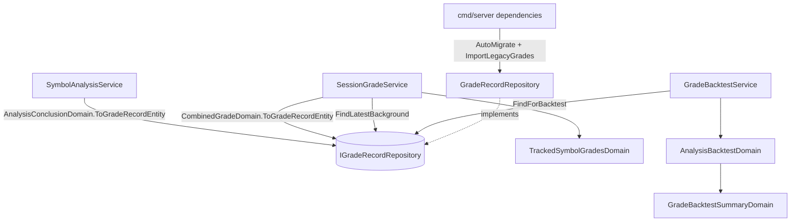

# 統一評等紀錄 — Architecture Design

**Status:** Confirmed
**Source PRD:** `.sdd/2026-10-28-unified-grade-record/PRD.md`
**Tech context:** Go 1.26 · Gin · GORM（PostgreSQL，Code First / `AutoMigrate`）· Clean / Onion Architecture

---

## 1. Design Goal & Guiding Principle

- **In one sentence:** 以一張 `grade_records`（entity `GradeRecord`，`Source` = `manual` / `background`）取代 `analysis_results` 與 `combined_grades`；手動分析完成與綜合評等重算都改成「新增一筆評等紀錄」，評等回測改讀評等紀錄並多一個來源篩選與依來源分組；啟動時把兩張舊表的資料搬進新表後移除舊表。
- **Guiding principle:** **「評等從哪來」只是一個欄位，不是一條分岔的程式路徑。** 回測、彙總、查詢都只認識 `GradeRecord`；兩種來源的差異只出現在「產生紀錄」那一刻（`AnalysisConclusionDomain.ToGradeRecordEntity` 與 `CombinedGradeDomain.ToGradeRecordEntity`）。下一種評等來源（例如時段評等）只要再多一個產生點與一個 `Source` 值，回測與彙總零修改。

---

## 2. Change Scope

| Area | Action | What / Why |
| :--- | :--- | :--- |
| `entities.GradeRecord`（`grade_record.go`） | **Add** | 統一的評等紀錄；`AnalysisKeyEvent` / `AnalysisEvidence` 移到各自檔案（`SessionGrade` 也用） |
| `entities.AnalysisResult`、`entities.CombinedGrade` | **Remove** | 由 `GradeRecord` 取代 |
| `vo.GradeSourceVo`（`grade_source_vo.go`） | **Add** | 來源值域 `manual` / `background` 與驗證（`ErrGradeSourceInvalid`「來源不正確」） |
| `IGradeRecordRepository` / `GradeRecordRepository` | **Add** | 取代 `IAnalysisResultRepository` 與 `ICombinedGradeRepository`（一個 entity 一個 repository） |
| `IAnalysisResultRepository`、`ICombinedGradeRepository` 與實作、mocks | **Remove** | 已無 entity |
| `persistence/legacy_grade_wire.go` | **Add** | 舊表的 wire 型別（只供一次性搬移），各自 `toGradeRecord()` |
| `GradeRecordRepository.ImportLegacyGrades` | **Add** | 組裝根於 `AutoMigrate` 後呼叫；舊表存在才搬，交易內「搬資料 + 刪舊表」 |
| `AnalysisConclusionDomain` | **Modify** | `ToResultEntity` → `ToGradeRecordEntity`（`Source = manual`） |
| `CombinedGradeDomain` | **Modify** | `ToEntity` → `ToGradeRecordEntity(symbol, symbolName, tradingDay, createdAt)`（`Source = background`、`TimeHorizon = short`） |
| `AnalysisEventDomain.ToDto` | **Modify** | 參數改 `*entities.GradeRecord`；回傳的分析結果內容不變 |
| `TrackedSymbolGradesDomain` | **Modify** | 改以追蹤標的建立；提供 `TrackingSymbols(filter)` 給 service 查詢；`ToDtos(latestGradeRecords, sessionGrades)` 由評等紀錄組 DTO，並自行排序（交易日新到舊、標的） |
| `AnalysisBacktestDomain` | **Modify** | 改包 `entities.GradeRecord`；明細多 `gradeRecordId`、`source`、`tradingDay`；`analysisEventId` 改可為 null |
| `GradeBacktestSummaryDomain` | **Modify** | 多 `bySource` 分組（手動、背景兩組恆列出） |
| `GradeBacktestFilterVo` | **Modify** | 多 `Source`（空＝兩種） |
| `SymbolAnalysisService` | **Modify** | 依賴換成 `IGradeRecordRepository` |
| `SessionGradeService` | **Modify** | 依賴換成 `IGradeRecordRepository`；盤前只刪時段評等；重算後 `Create` 一筆背景評等紀錄（帶追蹤標的名稱）；`GetTrackedSymbolGrades` 改查各追蹤標的最新一筆 |
| `GradeBacktestService` | **Modify** | 依賴換成 `IGradeRecordRepository`；驗證來源 |
| `GetGradeBacktestDto`、`GradeBacktestDto`、`AnalysisBacktestDto` | **Modify** | 新增 `Source` / `BySource` / 明細欄位 |
| `GradeBacktestController` | **Modify** | 讀 `source` query；`ErrGradeSourceInvalid` → 400 `grade_source_invalid` |
| `cmd/server/dependencies.go` | **Modify** | `AutoMigrate` 換 entity；呼叫 `ImportLegacyGrades`；DI 換 repository |
| `.mockery.yaml`、mocks | **Modify** | 移除兩個舊介面、加 `IGradeRecordRepository` |
| `postman/` | **Modify** | 回測新增 `source` 參數與 `bySource` 檢查 |
| 時段評等、時段執行紀錄、分析事件、價格服務 proxy | **Not touched** | PRD 不改它們的規則 |
| 對外 JSON：查詢分析事件、查詢追蹤標的評等 | **Not touched** | PRD 要求內容不變；`TrackedSymbolGradeDto.UpdatedAt` 取最新一筆的建立時間 |

---

## 3. New Classes / Modules

| Name | Kind | Responsibility (purpose) | Collaborators | Satisfies (PRD scenario) |
| :--- | :--- | :--- | :--- | :--- |
| `GradeRecord` | Entity | 欄位：`ID`、`Source`（size 16, not null）、`AnalysisEventID *uint`（uniqueIndex；背景為 null，Postgres 允許多個 null）、`Symbol`、`Category`、`SymbolName`、`TradingDay`（size 10，手動為空字串）、`Grade`、`Confidence`、`TimeHorizon`、`CombinedScore *float64`（手動為 null）、`Reason`（text, not null, default ''）、`KeyEvents` / `RiskFactors` / `Evidence`（jsonb, not null；背景為空陣列）、`Price` / `PriceCurrency` / `PricedAt` / `PriceSource`、`CreatedAt`。複合索引 `idx_grade_records_source_symbol_day`（`source`, `symbol`, `category`, `trading_day`, `created_at`） | — | 全部 |
| `GradeSourceVo` | VO | `GradeSourceManual = "manual"`、`GradeSourceBackground = "background"`；`NewGradeSourceVo(raw)` 非這兩個值回 `ErrGradeSourceInvalid` | — | 指定不存在的來源 |
| `IGradeRecordRepository` | Interface | `Create(ctx, *GradeRecord)`；`FindByAnalysisEventID(ctx, id) (*GradeRecord, error)`（查無回 nil）；`FindLatestBackground(ctx, []vo.SymbolVo) ([]GradeRecord, error)`（每個標的最新交易日的最新一筆背景紀錄，沒有就不列）；`FindForBacktest(ctx, vo.GradeBacktestFilterVo, limit)`（建立時間舊到新） | — | US-01、US-03、US-04、US-05、轉換後查詢分析事件 |
| `GradeRecordRepository` | Repository | 上述實作。`FindLatestBackground` 對每個標的以 `trading_day desc, created_at desc, id desc` 取 `First`（走複合索引，查詢量只與追蹤標的數有關，不隨紀錄累積變慢）。`FindForBacktest`：`(source = background) OR (analysis_event_id IN 已完成的分析事件)`，再疊期間、標的、來源條件 | GORM | US-03、US-04、US-05 |
| `GradeRecordRepository.ImportLegacyGrades(ctx) error` | Repository method（不在介面上，只由組裝根呼叫） | 一個交易內：`analysis_results` 存在 → 讀出全部、轉手動紀錄、`CreateInBatches`、`DropTable`；`combined_grades` 存在 → 依 `updated_at` 舊到新讀出、轉背景紀錄、寫入、`DropTable`。任一步失敗整個 rollback，下次啟動重做。舊表不存在即跳過＝不重複轉換 | `legacyAnalysisResult`、`legacyCombinedGrade` | US-06 全部 |
| `legacyAnalysisResult` / `legacyCombinedGrade` | 持久化 wire 型別（`legacy_grade_wire.go`） | 對應舊表欄位（`TableName()` 固定舊表名）；`toGradeRecord()` 轉成新 entity（比照 `go_trading_wire.go` 的 wire 型別定位） | — | US-06 |

---

## 4. Modified Components

| Component | Current role | Change needed |
| :--- | :--- | :--- |
| `SessionGradeService.RunDueTradingSession` | 盤前刪前一天的時段評等與綜合評等 | 只刪時段評等（`sessionGradeRepository.DeleteExceptTradingDay`） |
| `SessionGradeService.gradeTrackedSymbol` | 重算綜合評等並 upsert | `NewCombinedGradeDomain(...).ToGradeRecordEntity(symbol, vo.NewSymbolNameVo(trackedSymbol.SymbolName).Value, day, now)` → `gradeRecordRepository.Create`；失敗仍記 `FailureReasonCombinedGradeNotSaved` |
| `SessionGradeService.GetTrackedSymbolGrades` | 讀全部綜合評等再比對追蹤中標的 | 驗證篩選 → `FindAllTracking` → `TrackedSymbolGradesDomain.TrackingSymbols(filter)` → `FindLatestBackground` → 取這些交易日的時段評等 → `ToDtos` |
| `TrackedSymbolGradesDomain` | 由追蹤標的 + 綜合評等 + 時段評等組 DTO | `NewTrackedSymbolGradesDomain(trackingSymbols)`；`TrackingSymbols(vo.SymbolFilterVo) []vo.SymbolVo`（正規化、去重、套篩選）；`ToDtos(latestGradeRecords, sessionGrades)`（名稱取追蹤標的登記名，排序交易日新到舊、標的字母序） |
| `AnalysisBacktestDomain` | 一筆分析結果的回測規則 | 包 `GradeRecord`；規則不變（起點 = `CreatedAt`、時間範圍決定 N）；`toDto` 帶 `GradeRecordID`、`Source`、`AnalysisEventID`（*uint）、`TradingDay`（*string，背景才有） |
| `GradeBacktestSummaryDomain.ToDto` | 整體 / 市場 / 評等 / 信心分組 | 多 `BySource`（`manual`、`background`） |
| `GradeBacktestService.GetGradeBacktest` | 建立篩選、讀分析結果、取價、彙總 | 多驗證 `Source`（非空才驗）；讀 `gradeRecordRepository.FindForBacktest` |
| `GradeBacktestController` | query → DTO | 多 `source`；錯誤表多一列 400 `grade_source_invalid` |
| `ErrBacktestAnalysisLimitExceeded` 文字 | 「涵蓋分析超過 500 筆」 | 改「涵蓋評等紀錄超過 500 筆，請縮小期間」；錯誤碼不變 |

---

## 5. Component Relationships

---

## 6. Extensibility & Handoff Notes

- **Most likely next requirement:** 時段評等也要回測，或新增其他評等來源（例如美股自動追蹤）；或「列出某標的所有背景評等紀錄的歷史」。
- **Where it lands:** `GradeSourceVo` 加一個值 + 在產生點加一個 `ToGradeRecordEntity`；回測（`FindForBacktest` 的來源條件、`GradeBacktestSummaryDomain` 的 `gradeSources` 清單）只需把新值放進來源清單。歷史查詢 = `IGradeRecordRepository` 加一個查詢方法。
- **How to add it:** 不要為新來源開新表或新 repository；不要在 `AnalysisBacktestDomain` 內依來源分岔規則——規則差異應該在產生紀錄時就寫進 `TimeHorizon` 等欄位。
- **Patterns applied & why:** 單表 + 鑑別欄位（single-table with discriminator）：兩種來源 90% 欄位相同、讀取路徑（回測）完全相同，分表只會讓每個讀取者多一個 union。
- **Do not hardcode:** 來源值只住在 `GradeSourceVo`；回測的來源清單由 `GradeBacktestSummaryDomain` 的 `gradeSources` 統一列出。
- **Known debt / deferred:** `ImportLegacyGrades` 與 `legacy_grade_wire.go` 在所有環境都搬完後可整段刪除（訊號：沒有任何資料庫還有 `analysis_results` / `combined_grades`）。`FindLatestBackground` 每個追蹤標的一次查詢，追蹤標的上百檔時再改單一查詢。

---

## 7. Traceability

| PRD Scenario | Fulfilled by |
| :--- | :--- |
| US-01 當天第一次產生綜合評等 | `SessionGradeService.gradeTrackedSymbol` + `CombinedGradeDomain.ToGradeRecordEntity` + `GradeRecordRepository.Create` |
| US-01 同一天再次重算不覆蓋先前的紀錄 | `GradeRecordRepository.Create`（純新增，無 upsert） |
| US-01 時段評等失敗時不新增背景評等紀錄 | `SessionGradeService.gradeTrackedSymbol`（未結論即返回） |
| US-01 盤前只刪除前一天的時段評等，背景評等紀錄保留 | `SessionGradeService.RunDueTradingSession` |
| US-02 背景評等紀錄帶入追蹤標的登記的名稱 | `CombinedGradeDomain.ToGradeRecordEntity` + `SessionGradeService.gradeTrackedSymbol` |
| US-02 追蹤標的沒有登記名稱 | `vo.NewSymbolNameVo` → 空字串 |
| US-02 背景評等紀錄不帶理由、佐證與分析時價格 | `CombinedGradeDomain.ToGradeRecordEntity` |
| US-03 同一天有多筆時取最新一筆 | `GradeRecordRepository.FindLatestBackground` + `TrackedSymbolGradesDomain.ToDtos` |
| US-03 有多天紀錄時只取最新交易日 | `GradeRecordRepository.FindLatestBackground` |
| US-03 已暫停追蹤的標的不出現 | `TrackedSymbolGradesDomain.TrackingSymbols` |
| US-04 背景評等紀錄命中 | `AnalysisBacktestDomain`（`Source` 寫進明細） |
| US-04 台股開盤前建立的背景評等紀錄 | `AnalysisBacktestDomain`（既有起點規則） |
| US-04 同一天的多筆背景評等紀錄各自回測 | `GradeRecordRepository.FindForBacktest` + `AnalysisBacktestDomain` |
| US-04 未完成的手動分析不回測 | `GradeRecordRepository.FindForBacktest`（已完成分析事件子查詢） |
| US-04 背景評等紀錄尚未到期 | `AnalysisBacktestDomain`（短期 10 個交易日） |
| US-05 依來源分組顯示命中率 | `GradeBacktestSummaryDomain.ToDto`（`BySource`） |
| US-05 只看背景來源 | `GradeBacktestService` + `GradeBacktestFilterVo.Source` + `FindForBacktest` |
| US-05 沒有背景評等紀錄時顯示沒有資料 | `GradeBacktestSummaryDomain`（恆列兩組，`HitRate` nil） |
| US-05 指定不存在的來源 | `vo.NewGradeSourceVo` → `ErrGradeSourceInvalid` → controller 400 `grade_source_invalid` |
| US-05 兩種來源合計超過上限 | `GradeBacktestService`（limit + 1） |
| US-06 既有分析結果轉成手動評等紀錄 | `GradeRecordRepository.ImportLegacyGrades` + `legacyAnalysisResult.toGradeRecord` |
| US-06 既有綜合評等轉成背景評等紀錄 | `GradeRecordRepository.ImportLegacyGrades` + `legacyCombinedGrade.toGradeRecord` |
| US-06 不重複轉換 | `ImportLegacyGrades`（舊表不存在即跳過；交易內搬移 + 刪表） |
| US-06 轉換後查詢分析事件結果不變 | `GradeRecordRepository.FindByAnalysisEventID` + `AnalysisEventDomain.ToDto` |

---

## 8. Risks & Open Decisions

- **Risks / trade-offs:**
  - 搬移與刪表在同一個 Postgres 交易內（Postgres DDL 可交易），失敗即全部 rollback；代價是啟動時多一次讀寫，只有第一次啟動會發生。
  - `ImportLegacyGrades` 以 persistence 層測試（`TEST_POSTGRES_DSN` 指向 `_test` 資料庫）涵蓋搬移、只搬一次、失敗回滾、舊表讀不到；另以正式資料庫的副本實際啟動驗證筆數與內容。
  - `FindForBacktest` 的 `OR` 條件讓手動紀錄仍需子查詢判斷分析事件狀態；資料量在 500 筆上限下可接受。
- **Open decisions (for implementation):** 無。
