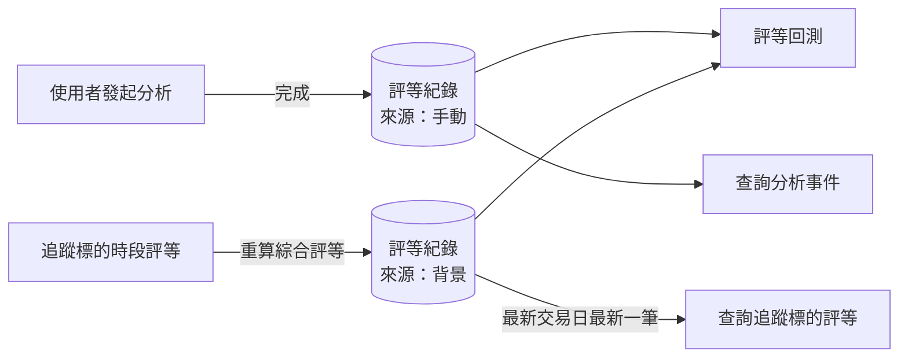

# Product Requirements Document (PRD) — 統一評等紀錄

**Status:** Draft
**Version:** v1.0
**Owner:** James Hsueh
**Stakeholders:** Engineering

---

## 1. Background & Goal (Why & Goal)

- **Problem Statement:** 評等回測只檢驗使用者發起的分析。追蹤標的每天自動產出的綜合評等只保留當天、每次重算就覆蓋，因此沒辦法回頭驗證它準不準。使用者在回測頁查只做過自動評等的標的（例如 4958），只會得到 0 筆。
- **Expected Outcome:**
  - 使用者發起的分析結果與追蹤標的的綜合評等，成為同一種「評等紀錄」，以「評等來源」（手動 / 背景）區分。
  - 每次重算綜合評等都留下一筆背景評等紀錄，永久保留。
  - 評等回測同時檢驗兩種來源，並能分開看各自的命中率，判斷自動評等是否也優於隨機猜測。
  - 既有的分析結果與綜合評等全部轉成評等紀錄，查詢分析事件與追蹤標的評等時，使用者看到的內容不變。
- **Out of Scope:**
  - 時段評等的回測與永久保留。
  - 背景評等紀錄取分析時價格，或補上分析理由與分析佐證。
  - 背景評等紀錄使用中期時間範圍。
  - 列出某標的全部背景評等紀錄歷史的新查詢。

---

## 2. User Personas

- **Primary Role(s):** 持有已啟用 API key 的使用者（實際上是專案擁有者本人）；administrator 維護追蹤標的清單。
- **Usage Context:** 不定期查詢評等回測，比較手動分析與追蹤標的自動評等的命中率，決定要不要調整追蹤標的或時段權重。

---

## 3. User Stories & Acceptance Criteria

### US-01 — 每次重算綜合評等都留下一筆背景評等紀錄 [priority: P0]
**As a** 使用者, **I want** 追蹤標的每次重算出的綜合評等都被保留下來, **so that** 日後能逐筆回測它們。

```gherkin
Scenario: 當天第一次產生綜合評等
  Given 追蹤標的 2330 週三還沒有任何背景評等紀錄
  When 週三盤前時段評等完成並重算綜合評等
  Then 2330 新增 1 筆背景評等紀錄，交易日為週三

Scenario: 同一天再次重算不覆蓋先前的紀錄
  Given 追蹤標的 2330 週三已有 1 筆盤前產生的背景評等紀錄
  When 週三盤中時段評等完成並重算綜合評等
  Then 2330 週三共有 2 筆背景評等紀錄
  And 盤前那一筆的評等與建立時間不變

Scenario: 時段評等失敗時不新增背景評等紀錄
  Given 追蹤標的 2330 週三盤中分析失敗，沒有產生盤中時段評等
  When 週三盤中執行結束
  Then 2330 週三的背景評等紀錄筆數不變

Scenario: 盤前只刪除前一天的時段評等，背景評等紀錄保留
  Given 有週二的時段評等與週二的背景評等紀錄
  When 週三盤前開始執行
  Then 週二的時段評等被刪除
  And 週二的背景評等紀錄仍然存在
```

### US-02 — 背景評等紀錄的內容 [priority: P0]
**As a** 使用者, **I want** 背景評等紀錄帶有標的名稱、評等來源與時間範圍, **so that** 它能和手動分析放在一起比較與回測。

```gherkin
Scenario: 背景評等紀錄帶入追蹤標的登記的名稱
  Given 追蹤標的 2330 登記名稱為「台積電」
  When 產生 2330 的背景評等紀錄
  Then 該紀錄的標的名稱為「台積電」、評等來源為背景、時間範圍為短期

Scenario: 追蹤標的沒有登記名稱
  Given 追蹤標的 4958 沒有登記名稱
  When 產生 4958 的背景評等紀錄
  Then 該紀錄的標的名稱為空

Scenario: 背景評等紀錄不帶理由、佐證與分析時價格
  Given 任一追蹤標的
  When 產生它的背景評等紀錄
  Then 該紀錄沒有分析理由、沒有分析佐證、分析時價格為「未取得」
```

### US-03 — 查詢追蹤標的評等取最新一筆 [priority: P0]
**As a** 使用者, **I want** 查詢追蹤標的評等時只看到每個標的最新的一筆綜合評等, **so that** 累積保留不會讓查詢結果變亂。

```gherkin
Scenario: 同一天有多筆時取最新一筆
  Given 追蹤標的 2330 週三有盤前（看多）、盤中（中性）兩筆背景評等紀錄
  When 使用者查詢追蹤標的評等
  Then 2330 只出現一次，綜合評等為中性

Scenario: 有多天紀錄時只取最新交易日
  Given 追蹤標的 2330 有週二與週三的背景評等紀錄
  When 使用者查詢追蹤標的評等
  Then 2330 只出現一次，交易日為週三，綜合評等為週三最新一筆

Scenario: 已暫停追蹤的標的不出現
  Given 追蹤標的 2330 有背景評等紀錄，但已暫停追蹤
  When 使用者查詢追蹤標的評等
  Then 結果中沒有 2330
```

### US-04 — 評等回測涵蓋兩種評等來源 [priority: P0]
**As a** 使用者, **I want** 評等回測同時檢驗手動與背景評等紀錄, **so that** 我能驗證追蹤標的的自動評等準不準。

```gherkin
Scenario: 背景評等紀錄命中
  Given 一筆看多的背景評等紀錄，週三 10:15 建立，起點價格 100
  And 之後第 10 個交易日收盤價 105
  When 使用者查詢評等回測
  Then 該筆回測結果為「命中」，評等來源標示為背景

Scenario: 台股開盤前建立的背景評等紀錄
  Given 一筆台股的背景評等紀錄，週四 08:30 建立
  When 使用者查詢評等回測
  Then 該筆的起點價格為週三收盤前最後一筆價格
  And 週四算作第 1 個交易日

Scenario: 同一天的多筆背景評等紀錄各自回測
  Given 追蹤標的 2330 週三有盤前、盤中、盤後 3 筆背景評等紀錄
  When 使用者查詢評等回測
  Then 逐筆明細列出這 3 筆，各自以自己的建立時間決定起點價格

Scenario: 未完成的手動分析不回測
  Given 一筆手動評等紀錄，但它所屬的分析事件不是已完成
  When 使用者查詢評等回測
  Then 逐筆明細中沒有這一筆

Scenario: 背景評等紀錄尚未到期
  Given 一筆背景評等紀錄，建立後才過 7 個交易日
  When 使用者查詢評等回測
  Then 該筆回測結果為「尚未到期」，不算進命中率
```

### US-05 — 依評等來源篩選與分組 [priority: P0]
**As a** 使用者, **I want** 依評等來源篩選回測、並看依來源分組的命中率, **so that** 我能比較手動分析與自動評等誰比較準。

```gherkin
Scenario: 依來源分組顯示命中率
  Given 手動可評估 10 筆、命中 6 筆
  And 背景可評估 20 筆、命中 9 筆
  When 使用者查詢評等回測
  Then 依來源分組：手動命中率 60%、背景命中率 45%
  And 整體命中率 50%

Scenario: 只看背景來源
  Given 手動可評估 10 筆、命中 6 筆
  And 背景可評估 20 筆、命中 9 筆
  When 使用者指定只看背景來源查詢評等回測
  Then 只計算背景的 20 筆，整體命中率 45%

Scenario: 沒有背景評等紀錄時顯示沒有資料
  Given 沒有任何背景評等紀錄
  When 使用者查詢評等回測
  Then 依來源分組中背景的命中率顯示「沒有資料」，不是 0%

Scenario: 指定不存在的來源
  Given 使用者指定的評等來源是「其他」
  When 使用者查詢評等回測
  Then 查詢被拒絕，說明「來源不正確」

Scenario: 兩種來源合計超過上限
  Given 符合條件的手動評等紀錄 300 筆、背景評等紀錄 201 筆
  When 使用者查詢評等回測
  Then 查詢被拒絕，並請使用者縮小期間
```

### US-06 — 既有資料轉成評等紀錄 [priority: P0]
**As a** 專案擁有者, **I want** 既有的分析結果與綜合評等都轉成評等紀錄, **so that** 歷史資料不會遺失，也能一起回測。

```gherkin
Scenario: 既有分析結果轉成手動評等紀錄
  Given 既有 9 筆分析結果
  When 服務啟動並完成轉換
  Then 有 9 筆手動評等紀錄，評等、分析理由、分析時價格、建立時間都與原本相同

Scenario: 既有綜合評等轉成背景評等紀錄
  Given 既有一筆 2330 週三的綜合評等，最後更新於週三 20:10
  When 服務啟動並完成轉換
  Then 有 1 筆 2330 的背景評等紀錄，建立時間為週三 20:10，時間範圍為短期

Scenario: 不重複轉換
  Given 既有資料已經轉換過
  When 服務再次啟動
  Then 評等紀錄的筆數不變

Scenario: 轉換後查詢分析事件結果不變
  Given 既有分析事件 #12 已完成
  When 轉換後使用者查詢分析事件 #12
  Then 回傳的分析結果與轉換前相同
```

---

## 4. Business Flow & Logic

- **Flow Diagram:**



- **Core Business Rules:**
  - 評等紀錄共通內容：評等來源、標的、市場類別、標的名稱、評等、信心指數、時間範圍、建立時間。
  - 手動評等紀錄另有：所屬分析事件、分析理由、關鍵事件、風險因子、分析佐證、分析時價格；一個分析事件最多一筆手動評等紀錄。
  - 背景評等紀錄另有：交易日、綜合分數；時間範圍一律短期；標的名稱取追蹤標的登記的名稱；沒有分析理由、佐證與分析時價格。
  - 綜合評等的計算方式（評等分數、時段權重、加權平均、門檻）不變，只是改為每次新增一筆背景評等紀錄、不覆蓋。
  - 背景評等紀錄永久保留；盤前開始時只刪除不是今天交易日的時段評等。
  - 評等回測：手動只算分析事件已完成者，背景全部都算；起點為評等紀錄的建立時間，起點價格與檢查點規則沿用既有回測規則；回測筆數上限 500 筆，兩種來源合計。
  - 評等回測可指定評等來源（手動 / 背景）；不指定涵蓋兩種；其他值拒絕並說明「來源不正確」。命中率總表多一個「依來源」分組，每組永遠列出手動與背景兩組。逐筆明細標出評等來源；手動紀錄附所屬分析事件編號，背景紀錄附交易日。
  - 既有資料轉換：分析結果 → 手動評等紀錄（內容、建立時間不變）；綜合評等 → 背景評等紀錄（建立時間取最後更新時間、時間範圍短期、標的名稱為空）。轉換完成後舊資料不再分開存在；同一筆舊資料不會被轉換兩次。
- **Edge Cases:**
  - 轉換途中服務中斷：下次啟動時重新轉換，已轉換的資料不會重複。
  - 綜合評等重算後保存失敗：該追蹤標的的時段結果記為失敗（比照既有「綜合評等保存失敗」原因），其他標的不受影響。
  - 背景評等紀錄的標的不在價格服務：回測結果為「無法評估」，比照手動。

---

## 5. UI/UX Design & Interaction

- **Prototype Link:** N/A（後端 API；前端另一個專案比照同一功能跟進）
- **Key Interactions:**
  - 評等回測頁：多一個「評等來源」篩選（全部 / 手動 / 背景）、多一張「依來源」分組的命中率表、逐筆明細多一欄評等來源。
  - 追蹤標的評等頁：顯示內容不變。

---

## 6. Non-Functional Requirements

- **Performance:** 查詢追蹤標的評等不可隨背景評等紀錄累積而越來越慢到明顯可感（每個標的只需讀最新交易日）。評等回測維持 500 筆上限。
- **Security:** 評等回測與查詢追蹤標的評等仍為受保護功能，需要已啟用且未撤銷的 API key。
- **Compatibility:** 查詢分析事件與查詢追蹤標的評等回傳內容不變；評等回測只新增內容（評等來源篩選、依來源分組、明細的評等來源與交易日）。
- **Analytics / Tracking:** N/A

---

## 7. Dependencies & Risks

- **External Dependencies:** 價格服務（go-trading）——回測背景評等紀錄同樣依賴它；前端專案需跟進顯示。
- **Known Risks:**
  - 背景評等紀錄一天最多 3 筆、高度相關（同標的同一天），可能讓依來源的命中率看起來比實際更有把握。
  - 回測 500 筆上限會因背景評等紀錄累積而更快達到，使用者需要更常縮小期間。
  - 轉換舊資料若出錯會影響歷史分析結果，需確保轉換前後內容一致。

---

## 8. Appendix

- `BRIEF.md`（本資料夾）
- 既有切片：`2026-10-07-tracked-symbol-session-grade`（時段評等與綜合評等）、`2026-10-09-analysis-grade-backtest`（評等回測）、`2026-10-28-symbol-name`（標的名稱）
